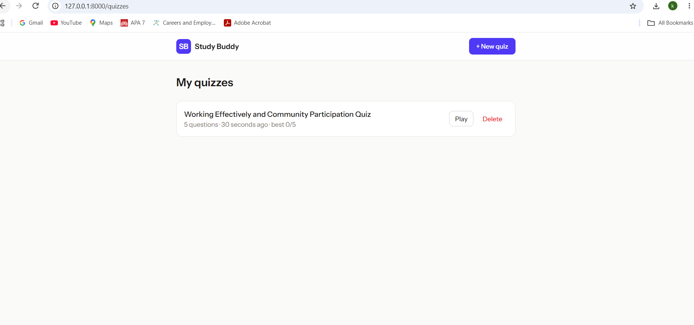
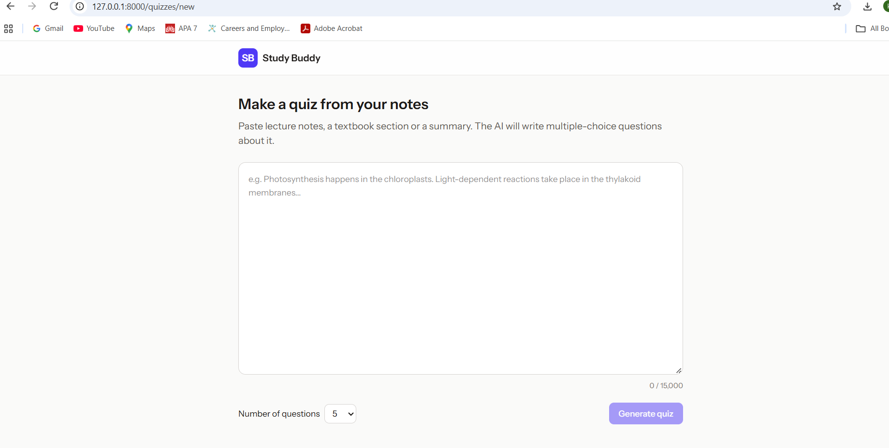
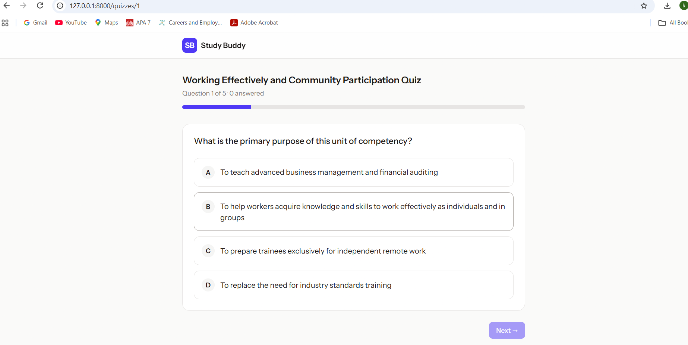
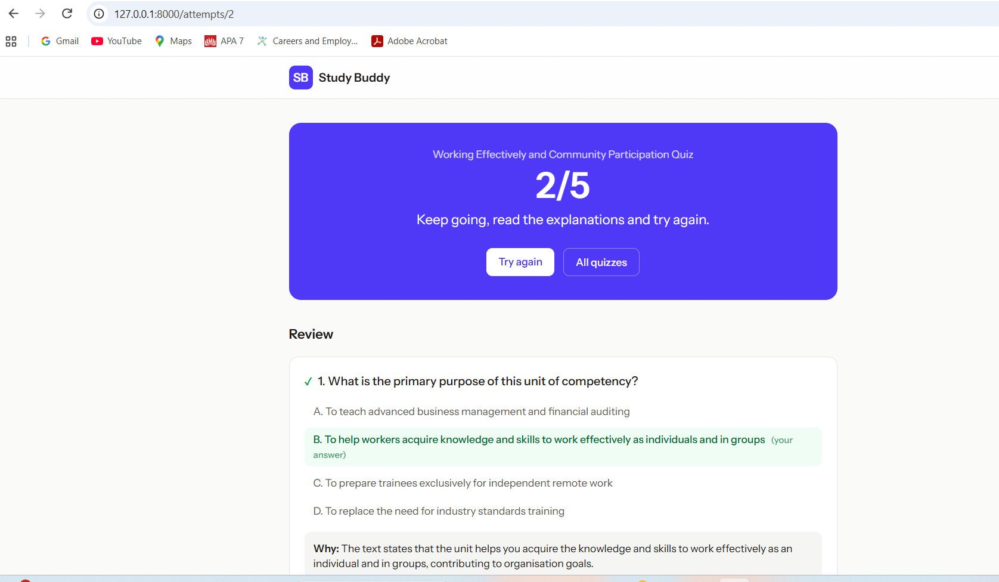

@'
# Study Buddy: AI Quiz Generator

Paste your study notes and AI turns them into a multiple-choice quiz. Answer the questions, get your score, and read an explanation for every answer.

## Screenshots

### My quizzes

### Create a quiz from notes

### Answer the questions

### Results with explanations

## Features
- Generates multiple-choice questions from any study notes using the Google Gemini API
- One question at a time with a progress bar
- Answers are graded on the server, so the correct answers are never sent to the browser
- Results page with explanations for every question
- Saves quizzes and best scores for each user
- Login and registration

## Tech stack
- **Backend:** Laravel (PHP)
- **Frontend:** React, TypeScript, Inertia.js, Tailwind CSS
- **AI:** Google Gemini API
- **Database:** MySQL

## Run it locally
1. Clone the repository and run `composer install` and `npm install`
2. Copy `.env.example` to `.env` and run `php artisan key:generate`
3. Add your database settings and `GEMINI_API_KEY` to `.env`
4. Run `php artisan migrate`
5. Run `composer run dev` and open http://127.0.0.1:8000
'@ | Set-Content -Path README.md -Encoding utf8